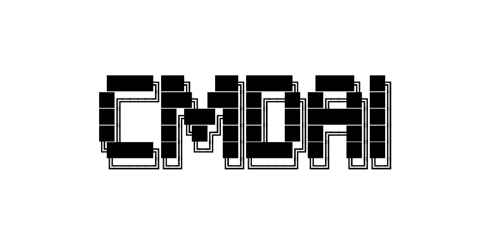

<div align="center">
  

  <p align="center">
    <a href="#"></a>
    <a href="#"></a>
    <a href="#"></a>
    <a href="LICENSE"></a>
  </p>

### Autonomous Local AI Runtime & CMDAI-CODE Controller
*Powered by local GGUF models (`llama.cpp`), Ollama/OpenAI-compatible HTTP server, and multi-provider cloud AI.*

</div>


## 🌟 About

**CMDAI** is a standalone Pitch-Black terminal AI runtime, Ollama/OpenAI-compatible model server, Hugging Face GGUF manager, and **CMDAI-CODE** orchestrator running directly inside your Windows console (Windows Terminal & PowerShell). Built for privacy, speed, and full local autonomy:
- **Local-First Runtime & Server**: Native support for quantized `.gguf` models via `llama.cpp` with Vulkan / CPU acceleration, plus a built-in multi-threaded HTTP server exposing Ollama (`/api/*`) and OpenAI (`/v1/*`) endpoints (`cmdai serve` / `/server`). Works best with **[LocalLLMAPI](https://github.com/DevP10TR/LocalLLMAPI)** for dedicated Vulkan/CUDA/CPU multi-slot local serving.
- **CMDAI-CODE Orchestrator**: Persistent TUI bridge (`<tool:cmdai_code>` / `/code`) that opens and controls external [CMDAI-CODE](https://github.com/DevP10TR/CMDAI-CODE) sessions per workspace — delegating rich natural-language engineering tasks, handling approval/clarification prompts autonomously, and syncing live progress.
- **Multi-Provider Cloud & MCP**: Seamless integration with local GGUF, Ollama, LM Studio, vLLM, OpenRouter, Anthropic, OpenAI, and Google Gemini, alongside Model Context Protocol (`MCP`) servers and cross-session global memory (`~/.cmdai/memory.md`).
- **Modern Terminal UI (TUI)**: Minimalist Pitch Black interface built on Textual — featuring a live TODO preview bar above the input, streaming thinking blocks, session tabs, and an interactive Hugging Face GGUF installer.

---

## 🚀 Key Features

- ⚡ **Local GGUF (Vulkan / CPU) & HTTP Server (`/server`)**: Automatic discovery, loading, and serving of `.gguf` weights from `models/` on `http://127.0.0.1:11434` with single-slot coordination for local inference.
- 🤗 **Hugging Face GGUF Hub (`/installmodels`, `/pull`)**: Live search of `.gguf` repositories with quantization extraction (`Q4_K_M`, `Q5_K_M`, `Q8_0`), RAM-fit badges (`Full fit`, `Tight fit`, `Exceeds RAM`), and resumable downloads.
- 🤖 **CMDAI-CODE Controller Bridge (`/code`, `<tool:cmdai_code>`)**: Supervises a live CMDAI-CODE TUI window per directory (`run`, `command`, `set_mode`, `approve`, `reject`, `interrupt`, `status`, `reset`, `close`), prevents bare shell delegation, and decides CMDAI-CODE prompts autonomously.
- 🗂️ **Advanced Session Manager (`/sessions`)**: Persistent conversation history, multi-tab session bar, live filtering, and isolated workspace state.
- ✅ **Live TODO Bar (`/todo`)**: Real-time checklist preview bar rendered directly above the prompt input, synced with both `<tool:todo>` and active CMDAI-CODE tasks.
- 🌐 **Custom AI Providers & MCP (`/models`, `/mcp`)**: Connect any OpenAI-compatible endpoint (`Ctrl+A` / `Ctrl+D`) and extend capabilities with external MCP servers, screenshots, and vision models.

---

## 📥 Installation

Choose your preferred installation method:

### 1. PowerShell
No Git or Node.js required. Automatically downloads, configures, and launches the application:
```powershell
irm https://raw.githubusercontent.com/DevP10TR/CMDAI/main/install.ps1 | iex
```

### 2. NPX
Execute directly from GitHub without prior installation:
```bash
npx github:DevP10TR/CMDAI
```

### 3. NPM
Install globally on your machine using npm:
```bash
npm install -g github:DevP10TR/CMDAI
```

### 4. PIP
Install directly into your Python environment:
```bash
pip install git+https://github.com/DevP10TR/CMDAI.git
```

### 5. PIPX
Run in an isolated Python application container:
```bash
pipx run --spec git+https://github.com/DevP10TR/CMDAI.git cmdai
```

### 6. Git Clone
Clone the repository and run the local launcher:
```powershell
git clone https://github.com/DevP10TR/CMDAI.git
cd CMDAI
.\install.bat
```

---

## 💻 CLI Commands

Once installed, use the global `cmdai` command from any directory:

| Command | Description |
| :--- | :--- |
| `cmdai` | Launch the CMDAI Pitch Black TUI |
| `cmdai serve [--port 11434]` | Run foreground Ollama + OpenAI-compatible HTTP server |
| `cmdai pull <repo> [quant]` | Download a `.gguf` model from Hugging Face into `models/` |
| `cmdai list` | List installed local `.gguf` models |
| `cmdai ps` | Show currently loaded model and live server status |
| `cmdai rm <model>` | Delete an installed `.gguf` model |
| `cmdai run <model_or_prompt>` | Interactive chat REPL or headless agent run |
| `cmdai code [task...]` | Delegate a coding task or launch CMDAI-CODE |
| `cmdai mcp [command]` | Manage Model Context Protocol servers (`list`, `add`, `remove`, `test`) |
| `cmdai addlocal` | Import a local `.gguf` model file |
| `cmdai update` | Update CMDAI from GitHub |
| `cmdai --install-launcher` | Install global Windows PATH launcher |

---

## ⌨️ Keybindings & Slash Commands

### Main In-App Slash Commands:
| Command | Description |
| :--- | :--- |
| `/models` | Select active local GGUF model or cloud provider |
| `/installmodels` | Browse and download `.gguf` models from Hugging Face |
| `/server` | Start, stop, and inspect the Ollama/OpenAI HTTP server |
| `/code` | Open or configure the CMDAI-CODE controller bridge |
| `/sessions` | Browse and switch saved conversation sessions |
| `/mode` | Switch execution mode (`auto`, `chat`, `ask`) |
| `/todo` | View and edit the project task checklist |
| `/mcp` | Manage and inspect connected MCP servers |
| `/memory` | View or manage global cross-session memory |
| `/help` | Complete cheat sheet and command reference |

### Keyboard Shortcuts:
- **`Enter`**: Submit prompt / select menu option
- **`Shift+Enter`**: Insert new line in prompt input
- **`Shift+Tab`**: Cycle execution mode (`auto` / `chat` / `ask`)
- **`Ctrl+T`**: Cycle reasoning / thinking level
- **`Esc`**: Close active modal / cancel generation
- **`Ctrl+A`**: In `/models` – add custom AI provider or import local GGUF
- **`Ctrl+D`**: Configure API key for selected provider

---

## 🛠️ Project Structure

```text
CMDAI/
├── cmdai.py                  # Main CLI entry point
├── cmdai.bat                 # Windows batch launcher
├── install.ps1               # Automated PowerShell installer with C progress bar
├── install.bat               # Local installation batch wrapper
├── package.json              # NPM package definition (supports npx github:...)
├── pyproject.toml            # Python package configuration
├── requirements.txt          # Python dependencies
├── bin/                      # Launcher wrappers (Node.js & Windows)
├── assets/                   # Banners and visual assets
├── src/cmdai/
│   ├── agent/                # Agent loop, tool specs, renderer & CMDAI-CODE delegation
│   ├── core/                 # GGUF engine, HTTP server, HF Hub, sessions & code bridge
│   ├── mcp/                  # Native Model Context Protocol (MCP) client
│   └── tui/                  # Console UI (Textual): screens, modals, Pitch Black theme
└── models/                   # Folder for local .gguf model weights (optional)
```

---

## 📄 License

This software is provided under a custom personal and non-commercial license. See the [LICENSE](LICENSE) file for complete terms and restrictions.  
Copyright (c) 2026 DevP10TR. All Rights Reserved.
